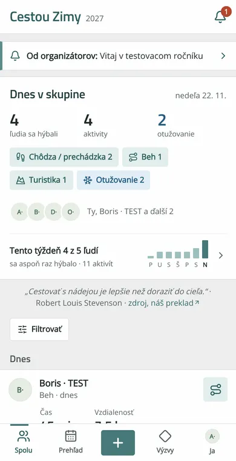
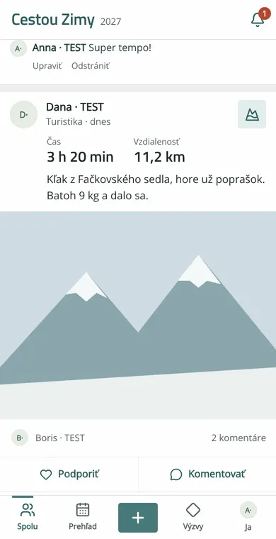
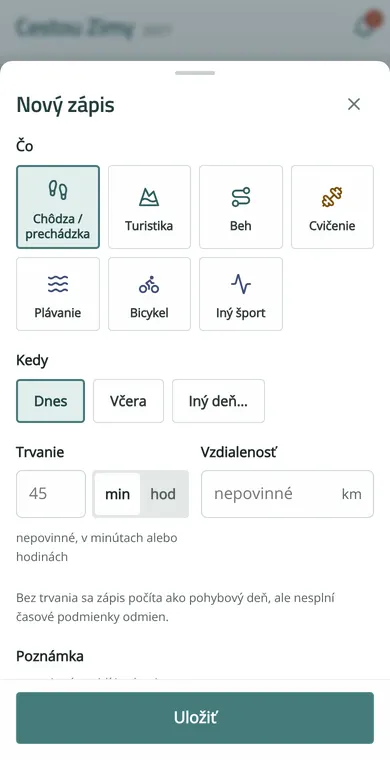
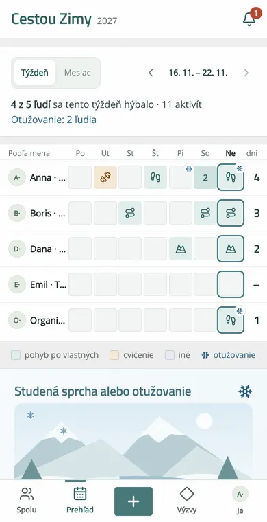
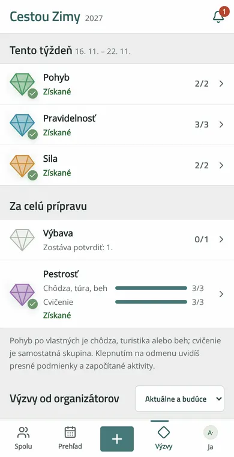
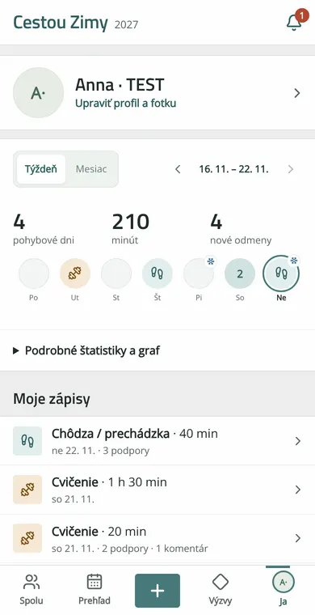
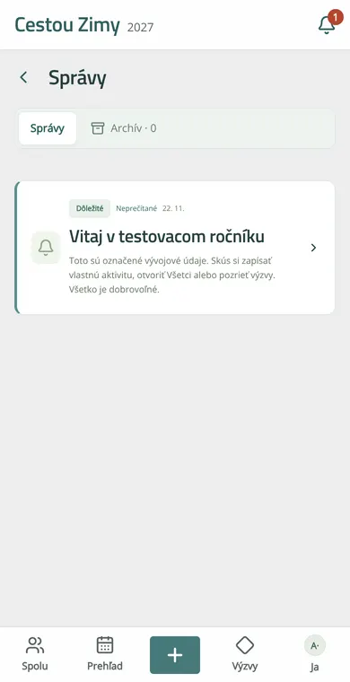

# Cestou Zimy — krátky návod pre účastníkov

Verzia: 22. 11. 2026 · screenshoty sú zo skutočnej aplikácie s ukážkovými údajmi (mená s označením TEST).

[Otvoriť verziu na vytlačenie](../public/navod.html)

Dole v appke je päť tlačidiel: **Spolu** (čo robí skupina), **Prehľad** (týždeň po ľuďoch), **+** (nový zápis), **Výzvy** a **Ja** (tvoja príprava a nastavenia).

**Pri prvom príchode:** otvor odkaz od organizátora a vyber **Prihlásiť sa**, prípadne **Vytvoriť účet**. Bez platnej pozvánky nový účet čaká na schválenie; potom použi **Skontrolovať schválenie**. Ak je tvoja prezývka už obsadená a účet patrí tebe, prihlás sa doň.

## 1. Spolu: čo robí skupina

Karta **Dnes v skupine** ukáže, koľko ľudí sa dnes hýbalo, aké aktivity pribudli a kto ich zapísal. Pod ňou sú aktivity všetkých, zoradené po dňoch. Cez **Filtrovať** vyberieš človeka, typ alebo obdobie.

## 2. Podpor a komentuj

Pod aktivitou stlač **Podporiť** alebo **Komentovať**. Vidíš, kto už podporil, a posledné dva komentáre; ostatné otvoríš cez počet komentárov. Klepnutím na meno otvoríš prípravu človeka.

## 3. Zapíš aktivitu tlačidlom +

Vyber typ, deň (**Dnes**, **Včera** alebo **Iný deň**) a prípadne trvanie, napríklad **90 min** alebo **1,5 hod**. Pridať môžeš vzdialenosť, poznámku a najviac päť fotografií (JPEG, PNG, WebP do 10 MB). Stlač **Uložiť**. Svoj zápis upravíš alebo zmažeš cez tri bodky na jeho karte.

## 4. Prehľad skupiny

Jeden riadok na človeka a 7 políčok týždňa, zoradené podľa prezývky. Hore prepneš **Týždeň / Mesiac**; appka si voľbu zapamätá. Klepnutím na políčko otvoríš deň, na meno celú prípravu človeka.

## 5. Výzvy a odmeny

Drahokamy tohto týždňa a celej prípravy aj to, čo ešte chýba. Klepnutím na odmenu uvidíš pravidlá a započítané aktivity. Nižšie sú výzvy organizátorov a **Moja zbierka**.

## 6. Pridaj vločku

Keď organizátor sprístupní otužovanie, v okne **Nový zápis** pribudne riadok **Otužovanie** s tlačidlom **+ vločka**. Jeden človek pridá jednu vločku denne; otužovanie nepridáva tréningové minúty. Zimnú krajinu a **Moje vločky** nájdeš v Prehľade.

## 7. Ja: tvoja príprava a nastavenia

Tvoj týždeň alebo mesiac, podrobné štatistiky, tvoje zápisy a nastavenia: profil a fotka, **Upozornenia na telefóne**, heslo, návod a odhlásenie.

**Aplikácia na ploche:** Android — ponuka prehliadača → **Nainštalovať aplikáciu** / **Pridať na plochu**. iPhone — Safari → **Zdieľať → Pridať na plochu**; upozornenia zapni po otvorení cez novú ikonu.

## 8. Správy a archív

Zvonček hore otvorí správy organizátorov; dôležitá správa je aj ako pruh na začiatku Spolu. Zvoľ **Beriem na vedomie · archivovať**; správa ostane v tvojom **Archíve** a ostatným sa nič nemení.

---

**Keď sa niečo nepodarí:** prečítaj hlášku pri formulári; pri neúspešnej fotografii môžeš nahratie zopakovať alebo zvoliť **Uložiť bez neúspešných fotografií**. Ak zabudneš heslo, ozvi sa organizátorovi. Svoje heslo mu neposielaj.
